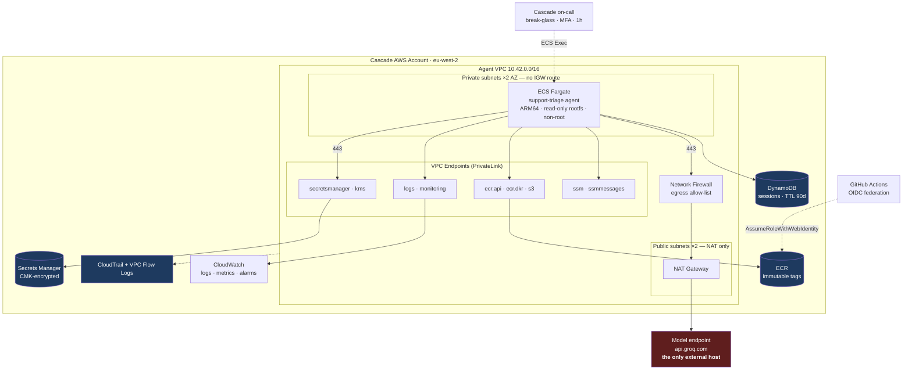

# Deployment Architecture

**System:** multi-agent customer support triage (router → billing / technical /
account specialists, three guardrail layers, $200 self-service refund ceiling
enforced inside the refund tool).

**Environment:** Cascade Retail Group's AWS account, `eu-west-2`,
customer-controlled. Every constraint below is treated as real.

---

## Customer constraints

Established before any design work. Each one removed options rather than
adding requirements, which is why the architecture is as small as it is.

| # | Constraint | Consequence |
|---|---|---|
| CC1 | Runs in the customer's AWS account; we have time-boxed access only | no vendor-hosted anything; handover is a hard requirement, not a phase |
| CC2 | Data does not leave `eu-west-2` | region pinned in code, and a `Deny` on any out-of-region call |
| CC3 | No general internet egress | VPC endpoints for AWS; **one** allow-listed host for the model |
| CC4 | No long-lived credentials anywhere | IAM roles only; CI federates via OIDC |
| CC5 | The customer is in PCI-DSS scope | the agent is explicitly denied cardholder-data stores |
| CC6 | Changes via Terraform only; console changes are a finding | drift detection in CI |
| CC7 | Customer security team reviews before production | IAM and network design shipped as reviewable documents |

**CC3 is the constraint that shaped everything.** An agent is, by nature, a
thing that calls an external model. Reconciling that with "no internet egress"
produced the single-exception design below, and it is the first thing the
customer's security team asked about.

---

## Architecture

---

## Components and ownership

| Component | Purpose | Owner after handover |
|---|---|---|
| VPC, subnets, endpoints | network boundary | Cascade platform engineering |
| Network Firewall | hostname egress allow-list | Cascade security |
| ECS Fargate service | runs the agent | Cascade platform engineering |
| ECR | image registry, immutable tags | Cascade platform engineering |
| Secrets Manager + KMS CMK | credentials at rest | Cascade security (key), platform (values) |
| DynamoDB | conversation state, 90-day TTL | Cascade platform engineering |
| CloudWatch | logs, metrics, alarms | Cascade platform engineering |
| CloudTrail, Flow Logs | audit | Cascade security |
| Terraform | the whole stack | Cascade platform engineering |

**Every row has a named owner.** An unowned component is one nobody patches,
and the handover is not complete until each of these is accepted by name — not
by team alias.

---

## Network boundaries

Three, in order of how much they are relied on:

**1 · The workload has no ingress at all.** The task security group has an
empty ingress block. The agent is not a server; it consumes work and calls out.
Any ingress rule appearing later is a finding, and `verify_deployment.py`
asserts its absence.

**2 · AWS traffic never leaves the AWS network.** Secrets, logs, metrics,
image pulls and DynamoDB all travel over VPC endpoints. Besides the security
property, this is also the cheaper path — NAT data processing is charged per GB
and container image pulls are not small.

**3 · Exactly one external host.** `api.groq.com`, enforced twice: the security
group narrows to 443/TCP, and Network Firewall narrows to a hostname. Security
groups cannot filter by hostname, which is why the second control exists rather
than being redundant.

The same allow-list is enforced in the local simulation by a Squid ACL, so a
developer who adds an outbound call discovers it on their laptop rather than in
the customer's VPC.

---

## Data flow and residency

| Data | Where it lives | Retention | Leaves the region? |
|---|---|---|---|
| Customer message text | in memory during a turn; DynamoDB for session context | 90 days (TTL) | **no** |
| Prompt sent to the model | transits to `api.groq.com` | not retained by us | **yes — this is the exception** |
| Tool arguments | hashed before logging | 90 days | no |
| Credentials | Secrets Manager, CMK | until rotated | no |
| Traces and metrics | CloudWatch | 90 days | no |

**The model call is the one place customer text crosses the boundary**, and it
is called out explicitly rather than buried. It requires a signed DPA with
zero-retention terms before production — listed as a deployment blocker, not a
follow-up.

---

## Availability and failure modes

| Failure | Behaviour | Recovery |
|---|---|---|
| A task crashes | ECS restarts it; the other AZ serves | automatic |
| An AZ fails | second AZ continues (2 tasks, 2 AZs, one NAT each) | automatic |
| Model endpoint unavailable | requests fail cleanly and are retried with backoff; no partial state is written | automatic, alarmed |
| Secrets Manager unavailable | existing tasks continue; **new tasks cannot start** | alarmed; known limitation |
| Bad deployment | circuit breaker rolls back automatically | automatic |
| DynamoDB throttled | on-demand billing absorbs it; alarmed above threshold | automatic |

The secrets dependency is stated plainly because it is the one that surprises
people: a running task has already read its secrets, so an outage looks fine
until something restarts.

---

## Cost

| Component | Monthly (est.) |
|---|---|
| Fargate 2×(0.5 vCPU, 1GB) ARM64 | ~$25 |
| NAT gateways ×2 | ~$70 |
| VPC endpoints ×9 interface | ~$65 |
| Network Firewall | ~$280 |
| DynamoDB on-demand, CloudWatch, ECR | ~$20 |
| **Total** | **~$460/month** |

**Network Firewall is 60% of the bill**, and it exists for one PCI control. It
is called out so the customer can make that trade knowingly — with
`enable_network_firewall = false`, the stack costs ~$180/month and the egress
boundary drops to port-level only. That is a decision for Cascade security, not
a default we should quietly pick for them.

Single-NAT mode (`single_nat_gateway = true`) saves a further ~$35 and makes an
AZ failure an outage.
